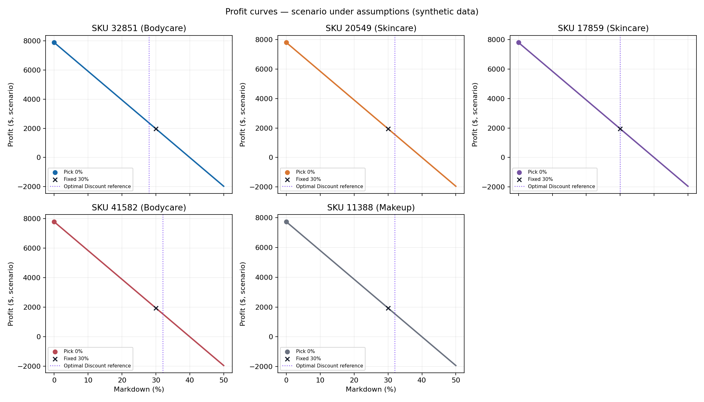

# Module 4 evidence — scenario under assumptions

> **Scenario under assumptions — synthetic data.** D2 identifies itself as
> synthetic. The profits and markdowns below are scenario outputs, not real
> retail outcomes, causal effects, or validated recommendations.

## Method and assumptions

The linear weekly demand curve for each product uses the four matched
`(Markdown_k, Sales_After_Mk)` pairs plus `(0, Historical_Sales)`. For each
markdown from 0% to 50% in 10-point increments, it projects demand over
8 weeks, caps units sold at stock, charges cost on all opening
stock, and credits salvage on leftover units. The historical-sales period is
assumed to be 13 week(s); default unit cost is 60%
of original price and salvage is 20% of unit cost.

**Markdown eligibility rule:** recommend a markdown only when stock cover,
`Stock_Level / (Historical_Sales / assumed_period_weeks)`, strictly exceeds
the simulated horizon. Otherwise hold at 0%, since baseline demand covers
opening stock within the horizon.

`Optimal Discount` appears only as a comparison column/reference marker. It
does not enter the demand fit, feature set, or profit maximization.

## Pick versus fixed 30% — first five differing SKUs

| Product ID | Category | Pick | Pick profit ($) | Fixed 30% profit ($) | Pick gain ($) | `Optimal Discount` reference only |
|---:|---|---:|---:|---:|---:|---:|
| 1 | Skincare | 0% | 5,152.55 | 1,288.14 | 3,864.41 | 36% |
| 2 | Skincare | 0% | -688.05 | -1,394.97 | 706.92 | 29% |
| 3 | Skincare | 0% | -410.93 | -649.88 | 238.95 | 33% |
| 4 | Bodycare | 0% | 2,264.95 | 566.24 | 1,698.71 | 25% |
| 5 | Skincare | 0% | 3,016.50 | 754.12 | 2,262.38 | 23% |

The recommendation differs from fixed 30% for 41,308 of 43,400 products. Among only those differing products, mean per-product profit difference (pick minus fixed 30%) is $1,143.09; median is $887.13. No portfolio-wide profit gap is reported. The mean absolute markdown difference from the supplied `Optimal Discount` comparison column is 25.7% across 43,400 products. `Optimal Discount` is not used to fit demand or choose the simulated markdown.

## Five SKU profit curves

The plotted five are the products with the largest per-product profit
improvement over fixed 30% among differing cases, under 60% cost / 20%
salvage. Markers show the selected markdown and fixed 30% comparison. The
purple vertical reference is the supplied
`Optimal Discount` value and is comparison-only.

The full plotted curves are saved to
`outputs/module4/evidence/sku_profit_curves.csv`.

## Economic sensitivity

For each cost/salvage combination in the 13-week historical-sales / 8-week
horizon scenario, “changed” counts products whose best grid markdown differs
from the default 60% cost / 20% salvage recommendation.

| Unit cost (% of original price) | Salvage (% of unit cost) | Changed recommendations vs 60/20 | Share changed | Mean picked markdown | Median picked markdown |
|---:|---:|---:|---:|---:|---:|
| 50% | 10% | 2,350 / 43,400 | 5.4% | 5.0% | 0.0% |
| 50% | 20% | 714 / 43,400 | 1.6% | 4.7% | 0.0% |
| 50% | 30% | 1,068 / 43,400 | 2.5% | 4.3% | 0.0% |
| 60% | 10% | 2,036 / 43,400 | 4.7% | 5.0% | 0.0% |
| 60% | 20% | 0 / 43,400 | 0.0% | 4.5% | 0.0% |
| 60% | 30% | 2,183 / 43,400 | 5.0% | 4.0% | 0.0% |
| 70% | 10% | 1,684 / 43,400 | 3.9% | 4.9% | 0.0% |
| 70% | 20% | 722 / 43,400 | 1.7% | 4.3% | 0.0% |
| 70% | 30% | 3,333 / 43,400 | 7.7% | 3.7% | 0.0% |

The complete 3×3 table is also in
`outputs/module4/evidence/markdown_economic_sensitivity.csv`.

## Historical-sales period and horizon sensitivity

`weeks_cover` is stock divided by assumed weekly baseline demand. For a
13- or 26-week historical period, weekly demand is `Historical_Sales` divided
by that period. “Stock below horizon demand” compares opening stock to
projected baseline units for the horizon.

| Assumed historical period (weeks) | Horizon (weeks) | Stock below horizon demand | Cover-eligible products | Products with markdown |
|---:|---:|---:|---:|---:|
| 1 | 4 | 42,987 (99.0%) | 405 | 54 (0.1%) |
| 1 | 8 | 43,400 (100.0%) | 0 | 0 (0.0%) |
| 1 | 16 | 43,400 (100.0%) | 0 | 0 (0.0%) |
| 13 | 4 | 3,651 (8.4%) | 39,737 | 21,336 (49.2%) |
| 13 | 8 | 16,302 (37.6%) | 27,086 | 10,963 (25.3%) |
| 13 | 16 | 32,189 (74.2%) | 11,199 | 3,038 (7.0%) |
| 26 | 4 | 98 (0.2%) | 43,299 | 25,570 (58.9%) |
| 26 | 8 | 3,651 (8.4%) | 39,737 | 21,336 (49.2%) |
| 26 | 16 | 16,302 (37.6%) | 27,086 | 10,963 (25.3%) |

| Sales-period assumption | Min | P10 | P25 | Median | P75 | P90 | Max |
|---|---:|---:|---:|---:|---:|---:|---:|
| 1 week (weekly interpretation) | 0.125 | 0.328 | 0.487 | 0.768 | 1.253 | 1.915 | 7.259 |

Under the weekly interpretation, stock is below baseline demand over four
weeks for 42,987 products
(99.0%).
These results are conditional on the period assumption; the source does not
define the sales measurement periods.
